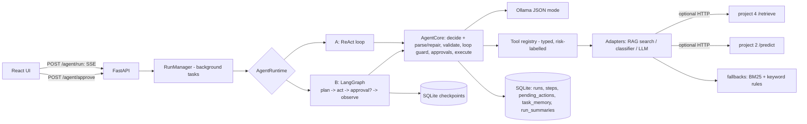

# 🤖 Document Agent (doc-agent-ai)

A **tool-using agent** that plans and completes multi-step tasks over the documents in a local folder. It calls tools
(search, read, classify, summarize, write a report, move/rename files) in a loop, **shows every thought, action and
observation live**, and **asks for your approval before any file-changing action** — with per-item checkboxes for batch
moves, editable arguments, a dry-run mode, loop detection and hard guardrails (no delete tool, no path outside `DOCS_ROOT`,
nothing is ever overwritten). Local-first: Ollama + SQLite, no cloud, no paid APIs.

> Project 5 of 5 · teaches agent design, tool calling, guardrails, human-in-the-loop UX, and how to test agents deterministically.

| Agent timeline | Approval card | History replay |
|---|---|---|
| _screenshot placeholder_ | _screenshot placeholder_ | _screenshot placeholder_ |

## Architecture



## Prerequisites
- Python 3.11+, Node 20+
- [Ollama](https://ollama.com): `ollama serve`, then `ollama pull llama3.1:8b` (a model that follows JSON formats; small 3B models often fail the protocol — the agent will say so after 2 repair attempts).

## Quick start (Windows PowerShell)
```powershell
git clone https://github.com/kamalnathmurugan14/doc-agent-ai; cd doc-agent-ai
ollama pull llama3.1:8b
cd backend
python -m venv .venv; .\.venv\Scripts\Activate.ps1
pip install -r requirements.txt
copy .env.example .env            # DOCS_ROOT=C:/Users/you/Documents/docs   (start with a COPY of your documents!)
uvicorn app.main:app --reload      # http://localhost:8000/docs

cd ..\frontend                     # new terminal
npm install
npm run dev                        # http://localhost:5173
```
macOS/Linux: `source .venv/bin/activate`, `cp .env.example .env`. The agent works with only the built-in fallbacks;
set `RAG_SERVICE_URL` / `CLASSIFIER_SERVICE_URL` to use projects 4 and 2 (they must point at the **same `DOCS_ROOT`**).

## Three demo tasks (try them on `backend/sample_docs`)
1. **"Summarize everything in the invoices folder into one report with totals."** → `list_files` → `read_file` ×N → approval card for `write_report` → file appears in `_reports/`.
2. **"Organize my files into folders by category (propose first)."** → classify each file → ONE approval card listing all moves with checkboxes; untick what you disagree with.
3. **"Find duplicate files and propose a clean-up plan."** → `find_duplicates` → a plan in the final answer (there is no delete tool; the agent can only propose or move/rename with your approval). Tick **Dry run** to see what *would* happen without touching anything.

## Configuration (`backend/.env`)
| Variable | Default | Meaning |
|---|---|---|
| `DOCS_ROOT`, `DATA_DIR` | `./sample_docs`, `./data` | The only folder the agent can touch · SQLite files |
| `MAX_UPLOAD_MB`, `ALLOWED_EXTENSIONS` | `25`, `pdf,docx,txt,md` | Upload limits; tools only see these types |
| `OLLAMA_BASE_URL`, `OLLAMA_MODEL` | `http://localhost:11434`, `llama3.1:8b` | Local LLM |
| `AGENT_MAX_STEPS` | `12` | Tool calls per run |
| `AGENT_STEP_TIMEOUT_S`, `AGENT_RUN_TIMEOUT_S` | `60`, `600` | Per LLM/tool call · per run (time waiting for you is not counted) |
| `REQUIRE_APPROVAL` | `write,move,rename` | Tool kinds that need approval (`write_report`=write, `move_file`=move, `rename_file`=rename) |
| `APPROVAL_TIMEOUT_S` | `3600` | A pending approval expires (= rejection) after this |
| `RAG_SERVICE_URL`, `CLASSIFIER_SERVICE_URL` | _(empty)_ | Optional adapters to projects 4 / 2 |
| `REPORTS_DIR` | `_reports` | Where `write_report` saves (never overwrites) |
| `MEMORY_RUNS` | `3` | Past task summaries shown to the agent (0 = off) |
| `MAX_TOOL_OUTPUT_CHARS` | `4000` | Tool output sent to the model is truncated |
| `CORS_ORIGINS` | `http://localhost:5173` | Allowed origins |

## API overview
Interactive docs at `/docs`; exported spec: [`docs/openapi.json`](docs/openapi.json). Errors: `{"error":{"code","message"}}`.

| Endpoint | Purpose |
|---|---|
| `POST /agent/run {task, runtime, scope?, max_steps?, dry_run?, plan?}` (SSE) | `run_started`, `plan`, `thought`, `action`, `observation`, `approval_required`, `approval_resolved`, `final`, `error`, `max_steps_reached` |
| `POST /agent/approve/{action_id} {decision, reason?, edited_args?, approved_items?}` | Resume a paused run; rejections go back to the agent as feedback |
| `POST /agent/runs/{id}/cancel` · `GET /agent/runs/{id}/events` | Stop a run · re-attach to its live stream |
| `GET /agent/runs`, `GET /agent/runs/{id}`, `GET /agent/actions/{id}` | History, full trace + pending actions |
| `GET /tools` | Name, description, JSON schema, risk, whether approval is required |
| `GET /health` | Ollama + adapters |
| `GET /fs/tree`, `POST /fs/upload`, `GET /fs/download`, `GET /fs/preview` | Path-safe explorer |

## Safety model (read this)
- **Allow-listed tools only; no delete, no shell.** Unknown tools get a corrective message.
- **Every path** is resolved and must stay inside `DOCS_ROOT` (`..`, absolute paths, drive letters, symlinks that escape). Reports go only to `REPORTS_DIR`.
- **Never overwrites**: reports get `_1`, `_2`…; moves/renames refuse existing destinations; extensions can't change.
- **Human in the loop** for every file change, with a preview; batch moves can be partially approved; rejection (or expiry) is fed back to the model.
- **Prompt-injection hygiene**: tool output is wrapped in `<untrusted_data>` and the system prompt says never to follow instructions inside documents. This *reduces* risk but a model can still be fooled — the **guardrails above do not depend on the model behaving**. See `tests/test_safety.py` (a compromised model that obeys `misc/injection_test.txt` changes nothing).
- **Budgets**: max steps, per-call timeouts, run timeout, loop detection (2nd identical action refused, 3rd stops the run).
- Start with a **copy** of your documents.

## Testing
```bash
make test                                    # or .\scripts\test.ps1
cd backend && pytest --cov=app               # 129 tests, ~94 % coverage - scripted fake LLM, no Ollama needed
cd frontend && npm run test:all              # eslint + tsc + vitest + build
cd frontend && npm run test:e2e              # Playwright: approve one of two moves, reject on LangGraph, replay history
```

## Troubleshooting
- **"The model kept returning invalid output"** – use a model that follows JSON (`llama3.1:8b` or larger).
- **Run stuck on "Waiting for approval"** – answer the approval card (or *Stop*). Pending actions expire after `APPROVAL_TIMEOUT_S`.
- **After a server restart** a ReAct run is marked *failed (interrupted)*; a LangGraph run can be approved and **continues from its SQLite checkpoint**.
- **Search finds nothing** – the fallback is BM25 over the file text (exact words); point `RAG_SERVICE_URL` at project 4 for semantic search.

## Roadmap
Editable plans (approve/modify the plan before acting) · streaming thoughts token-by-token · more tools (extract fields, compare documents) · per-tool permission profiles.

See also [Architecture](docs/ARCHITECTURE.md) · [Why agents fail](docs/WHY_AGENTS_FAIL.md) · [Learning notes](docs/LEARNING_NOTES.md) · [Demo script](docs/DEMO.md)
